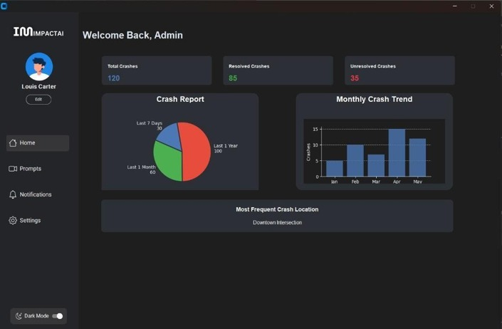
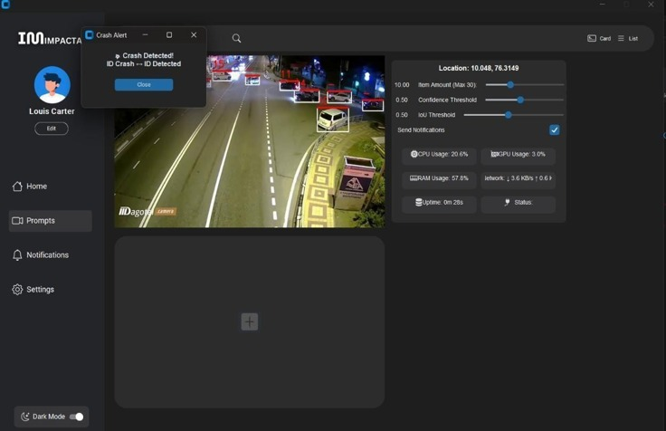

# 🚗 Impact AI – Crash Detection System

<p align="center">
  
    
  
</p> 

An AI-powered road accident detection system that uses **YOLOv8**, **OpenCV**, and **Firebase** to detect vehicle crashes in real time and instantly notify emergency responders.

## 📖 Overview

Road accidents often go unnoticed for critical minutes, delaying emergency response. Impact AI aims to reduce response time by automatically detecting accidents from video feeds using Artificial Intelligence and sending instant alerts through Firebase.

The project consists of:

- 🖥️ Python-based AI detection software
- 📱 Flutter mobile application
- ☁️ Firebase backend for real-time synchronization and notifications

---

## ✨ Features

- 🚘 Real-time crash detection using YOLOv8
- 📹 Supports CCTV footage and uploaded videos
- 🔍 Image and video processing with OpenCV
- 📲 Instant notifications using Firebase Cloud Messaging (FCM)
- 🗺️ Live crash location monitoring
- 👤 Admin dashboard for monitoring crashes
- 📱 Cross-platform mobile application
- ☁️ Cloud-based data storage using Firebase

---

## 🛠 Tech Stack

### Artificial Intelligence
- YOLOv8
- OpenCV
- PyTorch
- Python

### Mobile
- Flutter
- Dart

### Backend & Cloud
- Firebase Firestore
- Firebase Authentication
- Firebase Cloud Messaging (FCM)

### Tools
- VS Code
- Android Studio
- Git
- GitHub

---

## 🏗 System Architecture

```
Traffic Camera / Video
          │
          ▼
   OpenCV Processing
          │
          ▼
     YOLOv8 Model
          │
    Crash Detected?
       │        │
      No       Yes
                │
                ▼
      Firebase Firestore
                │
                ▼
 Firebase Cloud Messaging
                │
      ┌─────────┴─────────┐
      ▼                   ▼
 Admin Dashboard     Flutter App
```

---

## 📂 Project Structure

```
Impact-AI/
│
├── AI_Model/
│   ├── dataset/
│   ├── weights/
│   ├── train.py
│   └── detect.py
│
├── Flutter_App/
│
├── Admin_Software/
│
├── Firebase/
│
├── Assets/
│
└── README.md
```

---

## 🚀 Installation

### Clone Repository

```bash
git clone https://github.com/yourusername/Impact-AI.git

cd Impact-AI
```

### Install Python Dependencies

```bash
pip install -r requirements.txt
```

### Run AI Detection

```bash
python detect.py
```

### Run Flutter App

```bash
flutter pub get

flutter run
```


---

## 🔄 Workflow

1. Capture video from CCTV or upload footage.
2. Process frames using OpenCV.
3. Detect crashes using YOLOv8.
4. Store crash details in Firebase.
5. Send push notifications to users and emergency services.
6. Display results on the admin dashboard and mobile application.

---

## 🎯 Future Improvements

- Live CCTV streaming
- GPS integration
- Severity prediction
- Emergency service API integration
- Smart city deployment
- Edge AI deployment
- Multi-camera support

---

## 👨‍💻 Team

- George Joseph
- Mohammed Ameen
- Sahal Salam K A
- Salih P Ashraf

---

## 📄 License

This project is developed for educational and research purposes.

---

## ⭐ Support

If you found this project useful, consider giving it a ⭐ on GitHub.

```
Star ⭐ the repository if you like the project!
```
